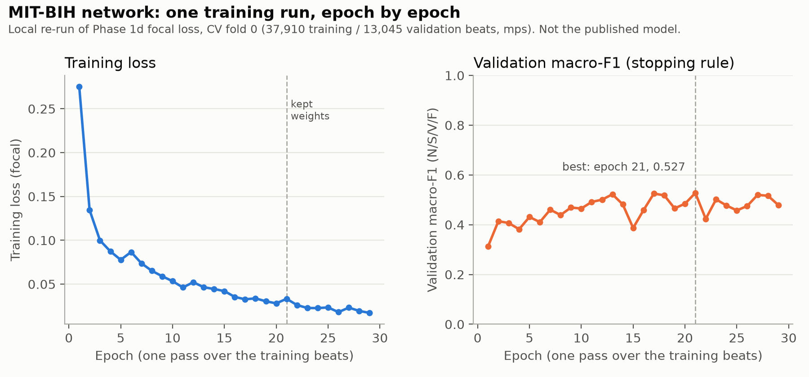
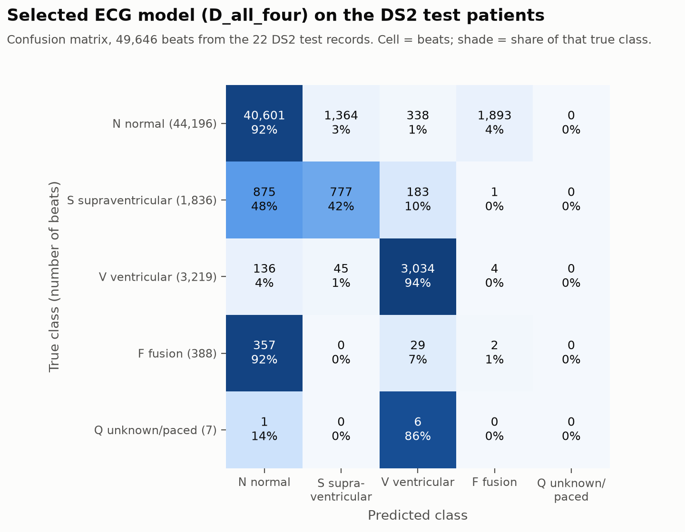
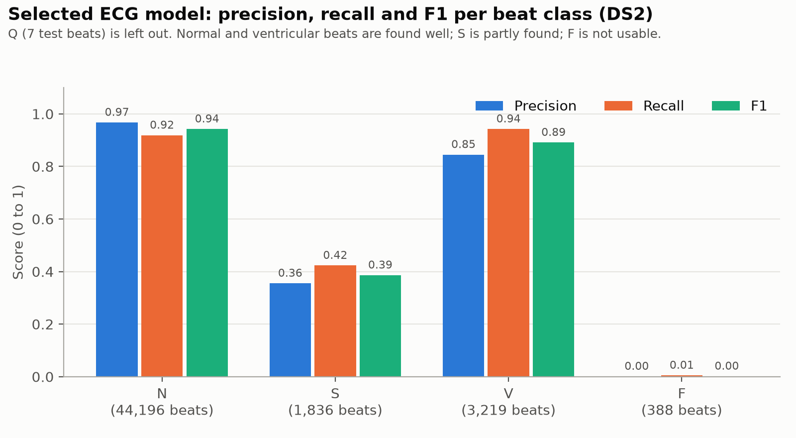
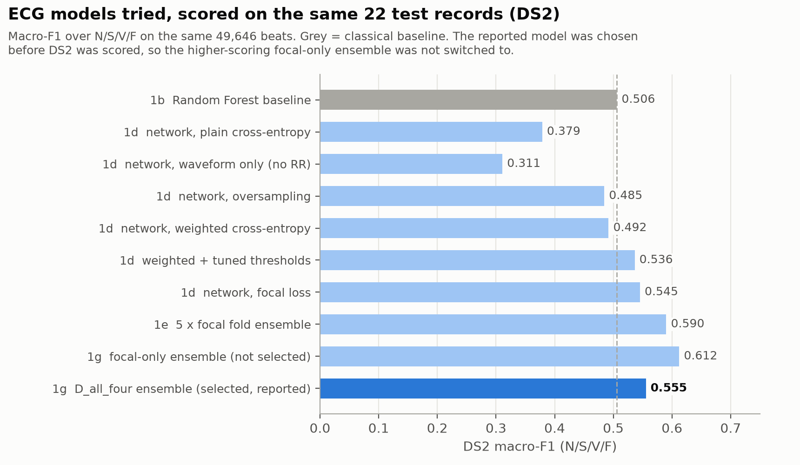
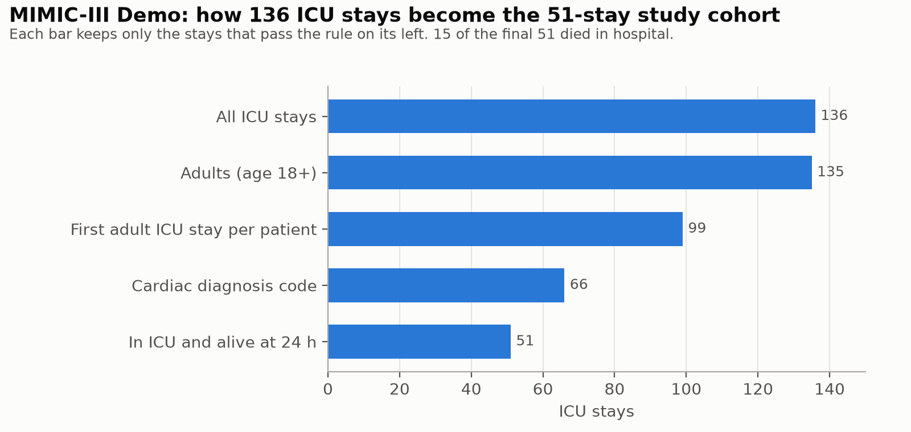
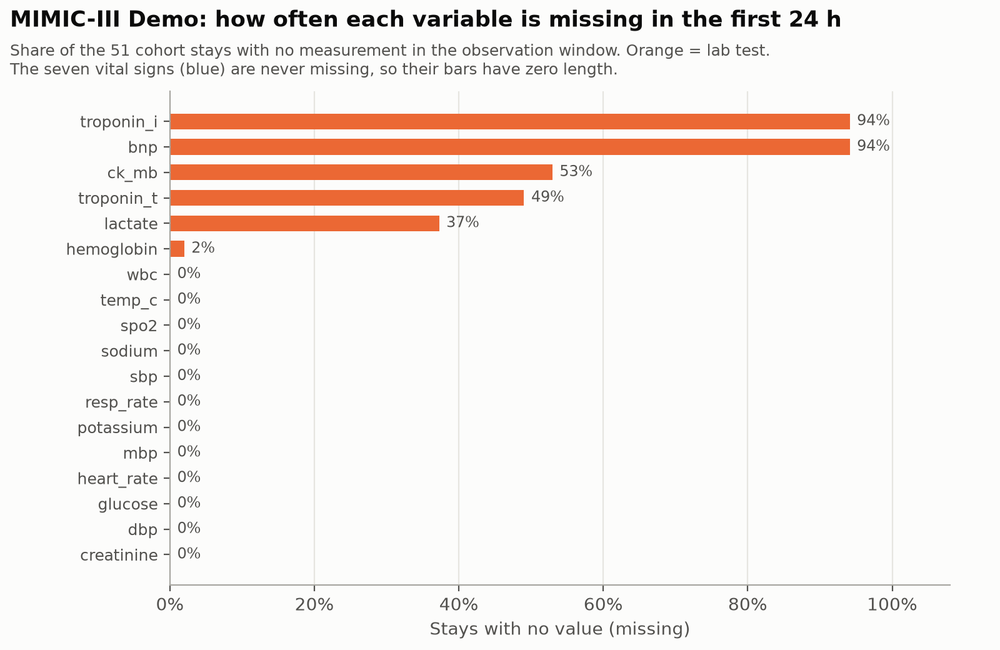
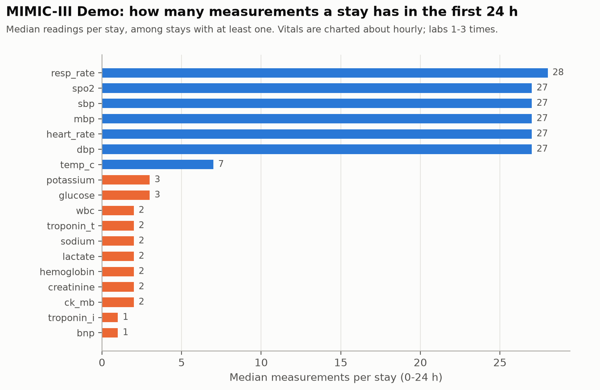
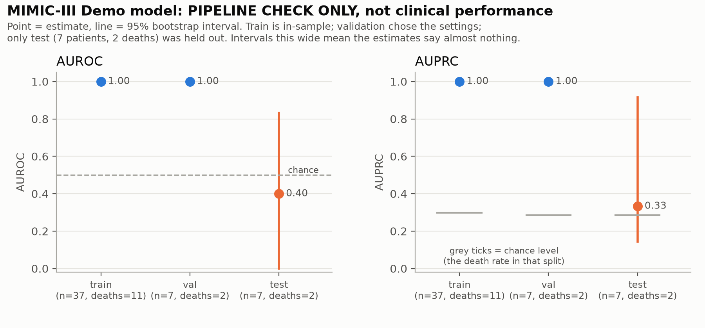
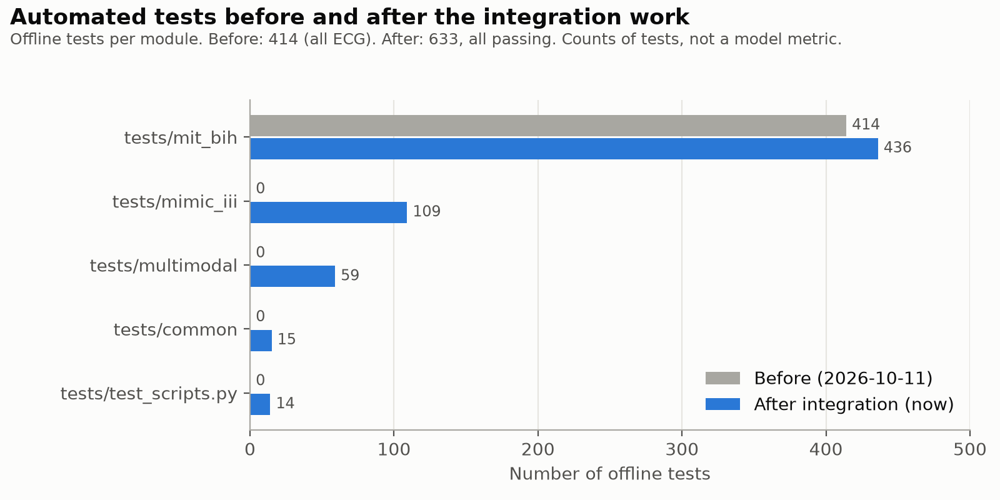
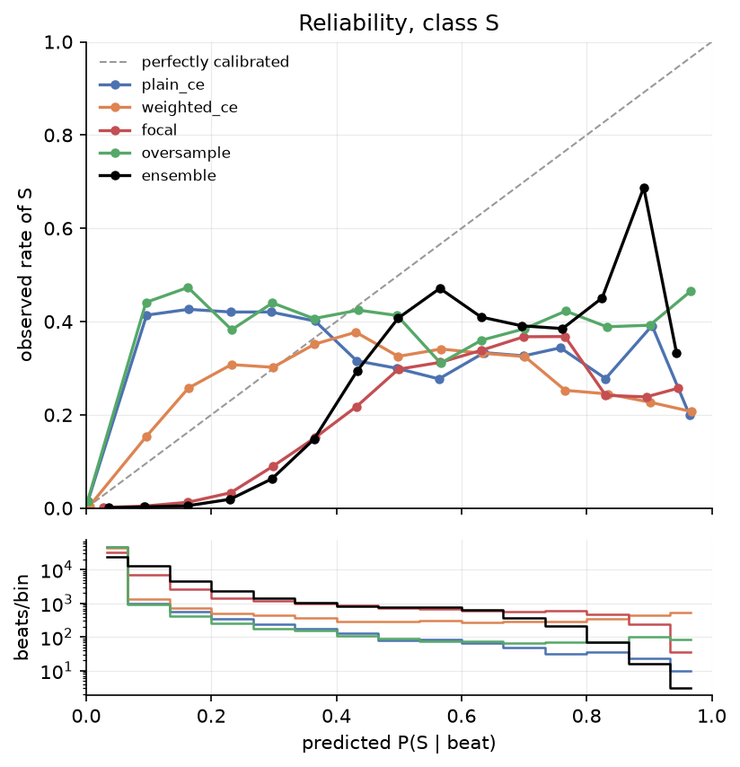

# MIT-BIH + MIMIC-III Integration Report

**Project:** SmartHealthcare-Agentic, an agentic cardiac-AI research system

**Status as of:** 14 October 2026

**Repository:** `Smart Healthcare/` (all file paths in this report are relative to it)

> **Summary in four sentences.** The ECG model (MIT-BIH) is trained and
> evaluated: on 22 held-out test recordings it reaches a macro-F1 of 0.555,
> against 0.506 for a classical baseline. The clinical pipeline (MIMIC-III) is
> built and tested, but it has only run on the 100-patient open Demo, so its
> model results mean nothing clinically. The two are integrated in software:
> one interface runs either or both models, and a fusion network is
> implemented and tested on synthetic data. **No multimodal model has been
> trained or evaluated on real data**, because no dataset available here has
> ECG and clinical records for the same patients.

Nothing in this project is a medical device or clinically validated. All
numbers below come from files in the repository; each one names its source.
Section 8 lists what is complete, partial and blocked.

**Contents**

| Section | What it covers |
|---|---|
| 1. Project overview | Aims, the two datasets, architecture diagram, integration status |
| 2. The project in 8 steps | Input, process, output, files, status, result and verification of each step |
| 3. Inputs and outputs | Formats and shapes for ECG, clinical and integration, with examples |
| 4. Before vs after integration | What changed, and what did not |
| 5. Results and graphs | Figures 1-10 with explanations; graphs that are not available |
| 6. Results summary | All metrics in one table, and what can be compared |
| 7. Files to show | Where each part lives in the repository |
| 8. Done and not done | Completed, partial and blocked items |
| 9. Next steps | Short, medium and long term |
| 10. What to say | Speaking script and likely questions |
| 11. Demonstration guide | Commands, expected output, what to show |
| 12. Conclusion | What the project shows and what it does not |
| Appendices | A: terms used; B: how this report was produced |

---

## 1. Project overview

### What the project is about

The project builds the data and model foundation for a cardiac AI system that
could one day look at a patient's heart rhythm and clinical record together.
It uses two public research datasets, which answer two different questions:

- **From the ECG:** *what kind of heartbeat is this?* Each heartbeat is
  labelled normal or one of four abnormal types.
- **From the clinical record:** *how likely is this ICU patient to die before
  leaving hospital?* The prediction is made 24 hours after ICU admission.

### Why MIT-BIH

The MIT-BIH Arrhythmia Database is the standard benchmark for heartbeat
classification. It has 48 half-hour ECG recordings from 47 people, sampled 360
times per second, and cardiologists labelled every one of its roughly 110,000
heartbeats. A published patient split (de Chazal et al., 2004, "DS1/DS2") lets
results be compared with other work. It is freely downloadable.

### Why MIMIC-III

MIMIC-III is the standard research database for intensive-care prediction:
de-identified records of ICU stays at a Boston hospital from 2001-2012, with
vital signs, lab tests, diagnoses and outcomes. The full database needs
credentialed access; a 100-patient Demo is open. This project currently has
the Demo only.

### Why integrate them

A clinician looks at the heart rhythm and the chart together. An ECG shows
rhythm problems; vital signs and lab tests show how sick the patient is. A
system that uses both could, in principle, know more than either alone. The
first step is software that can take both inputs; the second step, which
needs suitable data, is a model trained on both.

### ECG classification versus clinical prediction

| | ECG classification (MIT-BIH) | Clinical prediction (MIMIC-III) |
|---|---|---|
| What is predicted | The type of each heartbeat (N, S, V, F, Q) | In-hospital death (yes/no) |
| Unit of prediction | One heartbeat (0.83 s of signal) | One ICU stay |
| Input | A signal: voltage over time | Tables: vital signs, lab results, demographics |
| Time scale | Milliseconds to seconds | The first 24 hours of an ICU stay |
| Labels come from | Cardiologists annotating each beat | The hospital record (discharge status) |
| Patients | 47 people, recorded 1975-79 | ICU patients, 2001-2012 (Demo: 100) |

Because the targets, units and patients differ, the two models' scores cannot
be compared with each other or simply added together.

### System architecture

```text
   MIT-BIH ECG recordings                    MIMIC-III clinical tables
   (48 records, 360 Hz)                      (Demo: 100 patients)
            |                                          |
   [1] load, check integrity                  [1] load, check every table
   [2] filter, cut beats, label               [2] join safely, pick cohort,
   [3] waveform + 6 timing features               clean, convert units
   [4] patient split (DS1 / DS2)              [3] 24 h summaries, 113 inputs
            |                                 [4] split by patient
   [5] ECG model                                       |
   20-network ensemble                        [6] clinical model
   (trained, evaluated)                       logistic regression
            |                                 (runs; Demo only)
            |                                          |
   ECG encoder                                Clinical encoder
   per-beat classes + 13-value summary        119-value vector + risk score
            \                                          /
             +------ [7] shared inference interface --+
             |  checks each input, runs what applies, |
             |  returns each answer separately        |
             +----------------------------------------+
                                |
                   [7] fusion network (ConcatFusion)
                   built and tested on synthetic data;
                   training BLOCKED: no paired patients
                                |
                   [8] tests, end-to-end run, report
```

### Integration status in one table

| Part of the integration | Implemented | Tested | Trained on real data | Evaluated on real data |
|---|---|---|---|---|
| Shared inference interface | Yes | Yes (unit + real ECG record) | not applicable | Smoke-tested |
| ECG encoder | Yes | Yes | uses the trained ECG model | ECG model: yes |
| Clinical encoder | Yes | Yes | uses the Demo-trained model | Demo only |
| Fusion network | Yes | Yes, on synthetic data | **No** | **No** |

---

## 2. The project in 8 steps

### Step 1: Data collection and loading

- **Purpose.** Get the raw data onto the machine and prove it is complete and
  readable before anything is built on it.
- **Input.** MIT-BIH: 48 WFDB records from PhysioNet (a header `.hea`, a signal
  `.dat` and an annotation `.atr` file each). MIMIC-III: eight tables of the
  Demo v1.4 (`PATIENTS`, `ADMISSIONS`, `ICUSTAYS`, `DIAGNOSES_ICD`, `D_ITEMS`,
  `D_LABITEMS`, `CHARTEVENTS`, `LABEVENTS`).
- **Process.** MIT-BIH is downloaded once and every record's size and sampling
  rate are checked. The signal lead is chosen by name (MLII), not by position,
  because some records store a different lead first. For MIMIC-III, every
  table and required column is checked before reading; the readers accept
  both the Demo's format (lower-case `.csv`) and the full release's
  (upper-case `.csv.gz`). The two largest tables are read in chunks of one
  million rows, keeping only the rows needed, so the full 330-million-row
  `CHARTEVENTS` would fit in memory.
- **Output.** Raw data in `~/physionet-data/mitdb/` and
  `~/physionet-data/mimiciii-demo/`, outside the repository so patient data
  never enters version control.
- **Files.** `src/mit_bih/acquire.py`, `src/mit_bih/io.py`,
  `scripts/mit_bih/download_mitbih.py`, `src/mimic_iii/ingestion.py`.
- **Status.** Complete for MIT-BIH and the MIMIC-III Demo. Full MIMIC-III:
  **Blocked** (credentialed access needed).
- **Result.** 48 of 48 MIT-BIH records verify (93.9 MB). All 8 Demo tables and
  all 47 configured measurement codes (31 vital-sign, 16 lab) are present in the code dictionaries. In the Demo, 758,355 chart
  rows and 76,074 lab rows were read.
- **Verification.** `scripts/validate_setup.py` reports both as OK. Tests:
  `tests/mit_bih/test_download.py`, `tests/mit_bih/test_io.py`,
  `tests/mimic_iii/test_ingestion.py`. That last file includes a check that
  reading in small chunks gives exactly the same result as reading at once,
  and checks that missing tables, missing columns, bad dates and duplicate IDs
  are rejected with a clear error.

### Step 2: Data cleaning and preprocessing

- **Purpose.** Remove noise and errors, and put both datasets in a clean,
  consistent form.
- **Input.** The raw records and tables from Step 1.
- **Process, ECG.**
  - A band-pass filter (0.5-40 Hz) removes slow baseline drift and
    high-frequency noise. It is *zero-phase*, so heartbeats are not shifted in
    time.
  - Each annotated heartbeat is cut into a 300-sample window: 100 samples
    before the R peak (the tall spike of a heartbeat) and 200 after, which is
    0.83 seconds.
  - Cardiologists' beat symbols are mapped to the five AAMI classes: N normal,
    S supraventricular ectopic, V ventricular ectopic, F fusion, Q
    unknown/paced. 3,153 non-beat annotations (rhythm and noise markers) are
    excluded, and 48 beats whose window runs past the end of a recording are
    dropped and counted.
  - Each beat is scaled (z-score) using a mean and standard deviation
    computed from training records only.
  - The four recordings with pacemakers (102, 104, 107, 217) are excluded from
    the splits, following the AAMI standard.
- **Process, clinical.**
  - Tables are joined with checks: an ICU stay must belong to an admission of
    the same patient, or the program stops with an error.
  - Cohort: adults, each patient's first adult ICU stay, a cardiac diagnosis
    code, still in the ICU and alive 24 hours after admission.
  - Rows marked as errors are dropped. Temperatures recorded in Fahrenheit are
    converted to Celsius (331 readings in the Demo). Lab rows with an
    unexpected unit are dropped, never rescaled by guesswork. Physically
    impossible values are dropped (one respiratory rate in the Demo).
  - Missing values are kept as missing at this stage, together with a flag
    saying "not measured". They are filled in later, from training data only
    (Step 4).
- **Output.** `~/physionet-data/processed/mitdb-ds12/beats/<record>.npz`, one
  file per record with the beats, labels and R-peak positions (109,446 beats
  in total), plus a per-record accounting file. For MIMIC-III,
  `~/physionet-data/processed/mimiciii-demo/cohort.csv.gz` (51 ICU stays).
- **Files.** `src/mit_bih/filters.py`, `segment.py`, `labels.py`,
  `normalize.py`, `pipeline.py`; `src/mimic_iii/cohort.py`, `features.py`.
- **Status.** Complete.
- **Result.** The MIT-BIH counts match the published totals: 112,647
  annotations = 109,446 kept + 48 dropped at the edges + 3,153 non-beat. The
  MIMIC cohort goes 136 → 135 → 99 → 66 → 51 stays (Figure 5).
- **Verification.** Tests in `tests/mit_bih/` (filters, segmentation, labels,
  normalization, pipeline) and `tests/mimic_iii/test_cohort.py`. The tests
  check, for example, that an under-18 patient, a non-cardiac admission, a
  death before 24 hours and a patient's second ICU stay are each excluded.

### Step 3: Feature extraction

- **Purpose.** Describe each example with the numbers a model can learn from.
- **Input.** Clean beats; clean clinical measurements.
- **Process, ECG.** The network reads the 300-sample beat shape directly.
  Separately, six *RR-interval* features describe timing. The RR interval is
  the time between two heartbeats, and the six features are: the interval
  before the beat, the interval after it, the local average, the recording
  average, and the before/after intervals divided by that average.
  Supraventricular beats are defined by arriving early, which a cropped
  waveform cannot show, so the timing features matter.
- **Process, clinical.** For 18 variables in the 24-hour window (7 vital
  signs: heart rate, systolic/diastolic/mean blood pressure, respiratory rate,
  oxygen saturation, temperature; 11 lab tests: troponin T, troponin I, CK-MB,
  creatinine, potassium, sodium, BNP, lactate, glucose, hemoglobin, white
  cells), five summaries are computed: mean, minimum, maximum, last value and
  number of measurements. A missing-value flag is added for each variable,
  plus age, an over-89 flag, sex, admission type and first ICU unit. That
  gives 113 inputs.
- **Output.** ECG: per beat, a 300-number waveform and 6 timing numbers. Clinical:
  `features.csv.gz`, 51 rows × 113 model inputs (plus identifiers and the
  label, which never reach the model).
- **Files.** `src/mit_bih/features.py`, `src/mit_bih/dataset.py`;
  `src/mimic_iii/features.py`, `src/mimic_iii/config.py` (variable list,
  measurement codes, units, valid ranges).
- **Status.** Complete.
- **Result.** In the Demo cohort, every vital sign is present for every stay,
  while troponin I and BNP are missing for 94% of stays (Figure 6). Vitals
  have about 27 readings per stay in 24 hours, and labs 1-3 (Figure 7).
- **Verification.** `tests/mimic_iii/test_features.py` checks hand-computed
  values on a synthetic database (for example, a heart-rate mean of exactly
  90 from the readings 80, 90 and 100), the unit conversion, and that
  readings at or after the 24-hour mark are ignored.

### Step 4: Dataset splitting and preparation

- **Purpose.** Separate data for learning, for choosing settings, and for the
  final test, so the test is honest.
- **Input.** The beats and features from Step 3.
- **Process, ECG.** The standard *inter-patient* split: 22 recordings for
  development (DS1) and 22 different recordings for testing (DS2). Inside DS1,
  5-fold cross-validation groups beats by recording, so beats from one person
  are never on both sides. This means training on 4/5 of the recordings,
  checking on the rest, and rotating five times. The scaling statistics come
  from DS1 recordings only.
- **Process, clinical.** Patients (by `SUBJECT_ID`) are split 70% / 15% / 15%
  into training, validation and test, keeping the proportion of deaths
  similar in each. Missing-value filling (median), scaling and category
  encoding are fitted on training patients only, inside one combined model
  object.
- **Leakage prevention.** *Data leakage* means information from the test set,
  or from the future, reaching training, which makes results look better than
  they are. The rules:
  - **Rule 1.** Split by patient, never by beat or row.
  - **Rule 2.** Learn statistics from training data only.
  - **Rule 3.** Choose settings on validation data and score the test set once.
  - **Rule 4.** For clinical data, use only measurements taken before the prediction
     time. Diagnosis codes, discharge information and length of stay are
     never inputs.
  - **Rule 5.** Record a fingerprint (SHA-256 hash) of the feature table in the split
     file, so training refuses to run if the table changed after splitting.
- **Output.** `~/physionet-data/processed/mitdb-ds12/splits.json` (record
  lists); `~/physionet-data/processed/mimiciii-demo/splits.json` (patient
  lists).
- **Files.** `src/mit_bih/splits.py`, `src/mit_bih/folds.py`;
  `src/mimic_iii/dataset.py`, `src/mimic_iii/preprocessing.py`.
- **Status.** Complete, with one disclosed exception. MIT-BIH records 201
  (DS1) and 202 (DS2) come from the same person; record 202's header says it
  "was taken from the same analog tape as record 201". This is part of the
  published DS1/DS2 split that the field uses, and it is kept for
  comparability. Without record 202, the ECG model's test macro-F1 is
  0.567 (47,513 beats), slightly *higher* than with it, so the
  shared patient did not inflate the reported score.
- **Result.** ECG: 22 / 22 records (DS1 / DS2); 49,646 test beats. Clinical:
  37 / 7 / 7 patients with 11 / 2 / 2 deaths.
- **Verification.** `tests/mit_bih/test_splits.py` (no record in two splits;
  DS1/DS2 checked against two independent published sources),
  `tests/mit_bih/test_folds.py`, `tests/mimic_iii/test_dataset.py`,
  `tests/mimic_iii/test_preprocessing.py` (the fitted median and mean equal
  the training-only values). I also broke the code on purpose, by letting the
  training split contain every row and by including the 24-hour moment
  itself, and confirmed that tests fail.

### Step 5: MIT-BIH ECG model

- **Purpose.** Classify every heartbeat into N, S, V, F or Q.
- **Input.** Per beat: the 300-sample waveform, shape (1, 300), and the 6
  timing features.
- **Process.**
  - *Baseline:* a Random Forest on timing features plus a 30-number summary
    of the shape (Phase 1b).
  - *Network* (`HybridBeatNet`, 60,101 parameters): a 1-D convolutional branch
    (4 layers, 32 → 128 filters) reads the shape, a small dense branch reads
    the 6 timing features, and both are joined to output 5 class scores.
  - *Class imbalance:* 89% of test beats are normal, and F and S are rare.
    Five treatments were compared: plain cross-entropy, class weights,
    *focal loss* (a loss that focuses training on hard, rare examples),
    oversampling, and tuned thresholds.
  - *Training:* on a Google Colab GPU with the Adam optimiser (learning rate
    0.001, batch 256), stopping when validation macro-F1 had not improved
    for 8 epochs.
  - *Selection:* the final model, `D_all_four`, averages 20 networks (4 losses ×
    5 folds). It was chosen on DS1 cross-validation results before the test
    set was scored.
- **Output.** `models/` holds 36 checkpoint files. The 20 used by the final
  model are `models/mix_{focal,plain,weighted,oversample}_fold{0-4}.pt`.
  `models/mit_bih_inference_bundle.json` records the preprocessing settings
  and the checksum of every member, so the model can be applied to a new
  signal.
- **Files.** `src/mit_bih/nn/model.py`, `nn/losses.py`, `nn/train.py`,
  `ensemble.py`, `evaluate.py`, `inference.py`;
  `scripts/mit_bih/train_ensemble_mix.py`, `scripts/mit_bih/evaluate_bundle.py`.
- **Status.** Complete: trained and evaluated. Score calibration is not done.
- **Result (test set DS2, 49,646 beats):**
  - **Macro-F1 over N/S/V/F: 0.555**, against 0.506 for the Random Forest.
  - Recall (share of each class found): N 0.92, S 0.42, V 0.94, F 0.01.
  - Accuracy 0.895, which is not informative here: labelling every beat
    "normal" would already score 0.89.
  - See Figures 2-4.
- **Verification.** Re-scored on this laptop's CPU after the integration work:
  0.5554, identical to the original GPU result
  (`results/2026-10-14-bundle-eval-ds1_ds2.json`). Re-scored again starting
  from the raw recordings through the new inference code: also 0.5554, with an
  identical confusion matrix (`results/2026-10-14-bundle-eval-raw-ds1_ds2.json`).
  Four slow tests re-train small networks to check the imbalance handling
  still works; all pass.

### Step 6: MIMIC-III clinical model

- **Purpose.** Predict in-hospital death from the first 24 hours of an ICU
  stay.
- **Input.** 113 features per ICU stay, which become 119 numbers after
  categories are encoded.
- **Process.** A logistic regression with L2 regularisation and balanced class
  weights. Missing-value filling, scaling and encoding sit inside the same
  model object, so they are fitted on training patients only. The
  regularisation strength C (0.01, 0.1, 1 or 10) is chosen on the validation
  patients by AUPRC, and the decision threshold by Youden's index. Test
  patients are scored once. *AUROC* is the probability that a random death
  gets a higher score than a random survivor: 0.5 is chance, 1.0 is perfect.
  *AUPRC* summarises precision across thresholds, and its chance level equals
  the death rate. Both come with 95% bootstrap confidence intervals.
- **Output.** `model.pkl` and `model_meta.json` (the model, task definition,
  input columns and checksum) plus `report.md` / `report.json`, all in
  `~/physionet-data/processed/mimiciii-demo/`. An aggregate copy of the report
  is in `results/2026-10-14-mimic-demo-pipeline.md`.
- **Files.** `src/mimic_iii/preprocessing.py`, `train.py`, `evaluate.py`;
  `scripts/mimic_iii/build_features.py`, `make_splits.py`, `train.py`;
  settings in `configs/mimic_iii.toml`.
- **Status.** **Partial.** The software is complete and tested. A meaningful
  model is **Blocked**, because it needs full MIMIC-III.
- **Result (Demo; pipeline verification only):** C = 1, threshold 0.70.
  - Test: AUROC 0.40 (95% CI 0.00-0.83), AUPRC 0.33 (0.14-0.92), on 7
    patients with 2 deaths.
  - Training AUROC is 1.00, because the model memorises 37 patients with 113
    inputs.
  - The Demo's 100 patients were drawn from people who had all died by the
    time PhysioNet selected them.
  - These numbers show the code runs; they do not describe a model (Figure 8).
- **Verification.** `tests/mimic_iii/test_train_evaluate.py` and
  `tests/mimic_iii/test_cli.py` run the three scripts end to end on a
  synthetic database. Four real-Demo tests pin the cohort (51 stays, 15
  deaths).

### Step 7: MIT-BIH + MIMIC-III integration

- **Purpose.** Let one system accept ECG data, clinical data or both, and
  prepare for a model that combines them.
- **Input.** An ECG signal (360 Hz, single lead, optional R-peak positions)
  and/or one ICU stay's 113 features.
- **Process.**
  - *ECG encoder:* runs the ECG model and condenses any length of recording
    into 13 named numbers: the mean score per class, the share of beats
    predicted per class, mean and spread of the RR interval, and the log of
    the beat count.
  - *Clinical encoder:* turns the features into the model's 119-number vector
    and its risk score. It rejects any field that would be leakage, such as
    the outcome or length of stay.
  - *Shared interface* (`run_inference`): validates each input, runs what
    applies, and returns each answer in its own labelled section. A bad ECG
    does not stop the clinical answer, and vice versa. It never merges the two
    answers into one score.
  - *Fusion network* (`ConcatFusion`): projects each modality to 32 numbers,
    zeroes out a missing modality, adds two "present" flags, and outputs one
    score. During training it randomly hides one input so that it learns to
    work with either alone.
  - *Pairing check* (`validate_pairs`): refuses training data in which the ECG
    and clinical rows are not the same patient, the ECG was recorded after the
    prediction time, or MIT-BIH is paired with MIMIC-III.
- **Output.** A JSON result (Section 3). The fusion section reports
  `BLOCKED`.
- **Files.** `src/multimodal/ecg_encoder.py`, `clinical_encoder.py`,
  `inference.py`, `fusion.py`; `scripts/multimodal/infer.py`,
  `scripts/multimodal/train_fusion.py`.
- **Status.** Shared inference: **Complete**. Fusion architecture:
  **Complete, synthetic data only**. Real multimodal training and evaluation:
  **Blocked**.
- **Has real multimodal training happened? No.** MIT-BIH and MIMIC-III contain
  different people, and the two models predict different things. Training a
  fusion model on them would mean inventing patients.
- **Result.** On *synthetic* data where the label depends on both inputs, the
  fusion network reaches AUROC 0.897 using both, against 0.770 (ECG part only)
  and 0.778 (clinical part only). This shows the network can use both inputs.
  It is not a medical result.
- **Verification.** 59 tests in `tests/multimodal/`. One of them checks that the
  content of a missing input cannot change the output; when that safeguard was
  removed on purpose, the test failed. The inference smoke test ran on real
  MIT-BIH record 100 (Section 11).

### Step 8: Final testing, results and inference

- **Purpose.** Show that the whole system works and record what it produces.
- **Input.** The full repository and data folder.
- **Process.** Automated test suites; a setup check; one script that runs every
  step in order.
- **Output.** The files in `PlanDoc/integration_results/`:
  `verification_tests.txt`, `validate_setup.json`,
  `verification_end_to_end.md`, `demo_output_example.json` and the figures.
- **Files.** `tests/`, `scripts/validate_setup.py`,
  `scripts/run_end_to_end.py`.
- **Status.** Complete.
- **Result.**
  - 633 of 633 offline tests pass, 15 of 15 real-data tests and 4 of 4 slow
    training tests.
  - The setup check finds 16 OK, 1 missing (ECG calibration), 3 blocked
    (full MIMIC-III, paired data, fusion training) and 0 failures.
  - The end-to-end run finishes steps 1-7 in 70 seconds; step 8 (fusion
    training) correctly reports BLOCKED.
- **Verification.** Command outputs are saved verbatim in
  `PlanDoc/integration_results/verification_tests.txt` and
  `verification_end_to_end.md`.

### Summary table

| Step | Input | Process | Output | Status | Main file |
|---|---|---|---|---|---|
| 1. Load | 48 WFDB records; 8 MIMIC tables | Integrity and schema checks; chunked reading | Raw data on disk, verified | Complete (full MIMIC Blocked) | `src/mimic_iii/ingestion.py`, `src/mit_bih/io.py` |
| 2. Clean | Raw signals and tables | Filter, cut beats, label; validated joins, cohort, units, ranges | 109,446 beats; 51-stay cohort | Complete | `src/mit_bih/pipeline.py`, `src/mimic_iii/cohort.py` |
| 3. Features | Clean beats and measurements | Waveform + 6 RR features; 24 h summaries + flags | Beat tensors; 113 clinical inputs | Complete | `src/mit_bih/features.py`, `src/mimic_iii/features.py` |
| 4. Split | Features | Patient-level splits; train-only fitting | DS1/DS2; 37/7/7 patients | Complete (201/202 disclosed) | `src/mit_bih/splits.py`, `src/mimic_iii/dataset.py` |
| 5. ECG model | Beats + RR | 2-branch CNN, 20-model ensemble | Checkpoints, bundle, DS2 metrics | Complete | `src/mit_bih/nn/model.py`, `src/mit_bih/inference.py` |
| 6. Clinical model | 113 features | Logistic regression, choose on validation | Model, report | Partial (Demo only) | `src/mimic_iii/train.py` |
| 7. Integration | ECG and/or clinical | Encoders, shared interface, fusion network | Labelled JSON; fusion BLOCKED | Software complete; training Blocked | `src/multimodal/inference.py`, `src/multimodal/fusion.py` |
| 8. Testing | Repository | Tests, setup check, end-to-end run | Evidence files, figures | Complete | `scripts/run_end_to_end.py` |

---

## 3. Inputs and outputs

### MIT-BIH (ECG)

| Item | Format and shape |
|---|---|
| Raw input | WFDB record: 2 leads, 360 samples/s, 650,000 samples per lead (about 30 minutes), plus an annotation per beat (sample position + symbol). Only lead MLII is used. |
| After preprocessing | Per record, `beats/<record>.npz`: `X` (n, 300) float32 scaled beats, `y` (n,) class 0-4, `r_peaks` (n,) sample positions |
| Model input | beat tensor (batch, 1, 300) and RR tensor (batch, 6) |
| Classes | N normal · S supraventricular ectopic · V ventricular ectopic · F fusion · Q unknown/paced |
| Output per beat | 5 scores summing to 1 (averaged over the 20 networks); the predicted class is the largest. The scores are **not calibrated probabilities**: Phase 1f found the average predicted chance of S to be 3.2 times the true rate, and of F 14.5 times (Figure 10). |
| Saved artifacts | `models/mix_*_fold*.pt` (20 networks), `models/mit_bih_inference_bundle.json` (preprocessing + scaling statistics mean 0.0072, std 0.380 + checksums) |

**Example output (real, MIT-BIH record 100, first 60 seconds,** from
`PlanDoc/integration_results/demo_output_example.json`**):** 74 R peaks given →
2 dropped at the window edges and 2 without a neighbour for timing → **70 beats
classified: 69 N, 1 S, 0 V, 0 F, 0 Q**. Mean scores: N 0.913, S 0.057, V 0.002,
F 0.012, Q 0.016.

### MIMIC-III (clinical)

| Item | Content |
|---|---|
| Input tables and columns | `PATIENTS` (subject, sex, date of birth) · `ADMISSIONS` (admission type, death time, discharge time, `hospital_expire_flag`) · `ICUSTAYS` (ICU in/out time, first unit) · `DIAGNOSES_ICD` (ICD-9 codes: cohort selection only) · `CHARTEVENTS` (vital signs: item code, time, value) · `LABEVENTS` (lab results: item code, time, value, unit) · `D_ITEMS`, `D_LABITEMS` (code dictionaries) |
| Generated features | 18 variables × {mean, min, max, last, count} + 18 missing flags + age, age-over-89 flag, sex, admission type, first ICU unit = **113 inputs** |
| Processed table | `features.csv.gz`: one row per ICU stay, 3 IDs + label + 113 inputs (51 rows on the Demo) |
| Model input | 113 columns → 119 numbers after encoding categories |
| Target | `hospital_expire_flag`: death before hospital discharge, after the 24-hour prediction time |
| Output | Risk score from 0 to 1, the decision threshold (0.70), and whether the score is above it |
| Saved artifacts | `model.pkl` + `model_meta.json` (with checksum), `splits.json`, `build_summary.json`, `report.md/json`, in `~/physionet-data/processed/mimiciii-demo/` (outside the repository: they derive from patient rows) |

**Example input (invented, not a patient)**, from
`PlanDoc/integration_results/example_clinical_input.json`:

| Field | Value | Field | Value |
|---|---|---|---|
| age | 72 | heart_rate_mean | 96 |
| gender | M | sbp_min | 82 |
| admission_type | EMERGENCY | spo2_min | 89 |
| first_careunit | CCU | lactate_max | 3.6 |
| creatinine_last | 1.8 | troponin_t_max | 0.55 |

**Example output** for that invented input, from the Demo-trained model:
risk score **0.250**, threshold 0.700, *above threshold: false*. 78
unspecified fields were filled in and listed. The output carries the warning
"PIPELINE VERIFICATION ONLY". The score is meaningless as medicine; it shows
the format.

### Integration

| Component | Input | Output |
|---|---|---|
| ECG encoder | signal (1-D array), sampling rate (must be 360), optional R-peak positions | per-beat classes and scores, plus a 13-number summary |
| Clinical encoder | a dictionary of up to 113 features | 119-number vector and a risk score; lists filled-in and ignored fields; rejects outcome and ID fields |
| Fusion network | ECG summary (batch, 13), clinical vector (batch, 119), two presence flags (batch,) | one score per patient, from 0 to 1 |
| Final output | — | JSON with sections `ecg`, `clinical`, `fusion`, `patient_linkage`, `disclaimer` |

Shortened real output from `scripts/multimodal/infer.py`:

```json
{
  "modalities_received": ["ecg", "clinical"],
  "patient_linkage": "not asserted: the ECG and clinical outputs below are independent and must not be combined",
  "ecg": {"status": "ok", "model": {"ensemble": "D_all_four", "n_models": 20},
          "summary": {"n_beats_classified": 70,
                      "predicted_class_counts": {"N": 69, "S": 1, "V": 0, "F": 0, "Q": 0}}},
  "clinical": {"status": "ok", "risk_score": 0.24985, "threshold": 0.700553,
               "above_threshold": false, "is_demo_model": true},
  "fusion": {"status": "BLOCKED",
             "reason": "No fusion model trained on genuinely paired ECG + clinical data exists. ..."}
}
```

---

## 4. Before integration vs after integration

*Before* means the project as it stood before the integration work of 14
October 2026: commit `156d81a` plus the same-day reorganisation into three
packages. *After* means the end of 14 October 2026.

**Before integration.**

- **MIT-BIH** could classify beats that the Phase 1 pipeline had already saved
  to disk. It scored macro-F1 0.555 on DS2. There was no way to apply the
  model to a new ECG signal, because the scaling statistics it needs lived in
  a data folder outside the repository.
- **MIMIC-III** had one exploration script
  (`scripts/mimic_iii/explore_demo.py`) with no tests, no splits and no model.
- **Outputs:** per-beat class scores from the ECG model; aggregate tables from
  the MIMIC exploration.
- **Limitations:** no clinical model, no common interface, no fusion code, and
  the ECG scores were (and are) uncalibrated.

**After integration.**

- **Software architecture:** four packages (`mit_bih`, `mimic_iii`,
  `multimodal`, `common`) with one-way dependencies. `mimic_iii` became a
  tested pipeline, and the ECG model gained an inference bundle and a
  raw-signal path.
- **One interface:** yes. `run_inference` calls either or both models.
- **Features actually fused:** no. The fusion network exists and has run on
  synthetic data; no real ECG and clinical features have been fused.
- **Fused model trained:** no.
- **Combined system evaluated:** only as software (tests and smoke runs). Not
  as a predictor.
- **New capability demonstrated:**
  - Classify a raw ECG signal end to end.
  - Turn MIMIC-III tables into a leakage-checked prediction.
  - Query both through one call, with labelled, separate answers.
  - Refuse unsafe pairings.

| Feature | Before integration | After integration | Evidence |
|---|---|---|---|
| ECG classification | From saved beats only; DS2 macro-F1 0.555 | Also from a raw signal; DS2 macro-F1 **unchanged**, 0.5554 by both routes | `results/2026-10-14-bundle-eval-ds1_ds2.json`, `...-raw-ds1_ds2.json` |
| Clinical prediction | None (exploration script, no tests) | Tested pipeline and model; runs on the Demo; results not clinically meaningful | `src/mimic_iii/`, `results/2026-10-14-mimic-demo-pipeline.md` |
| Shared inference | None | One function for ECG, clinical or both | `src/multimodal/inference.py`, `demo_output_example.json` |
| Feature fusion | None | Architecture implemented; tested on synthetic pairs only | `src/multimodal/fusion.py`, `tests/multimodal/test_fusion.py` |
| Model training | ECG trained (Colab GPU) | ECG unchanged; clinical trains on the Demo; **fusion not trained** | `scripts/multimodal/train_fusion.py` → BLOCKED |
| Evaluation | ECG on DS2 | ECG re-verified; clinical on 7 Demo test patients; **fusion not evaluated** | Figures 2, 8 |
| Patient-level prediction | Per heartbeat only | Per heartbeat (ECG) and per ICU stay (clinical), separately; **no combined patient-level prediction** | Section 3 |
| Automated tests | 414 offline, 9 real-data | 633 offline, 15 real-data | Figure 9, `verification_tests.txt` |

**The integration is architectural.** It connects the two systems in
software and prepares for a combined model, but it does not combine
predictions, and no performance change can be attributed to it. A
before-versus-after *performance* graph is therefore **not available because
the required experiment (ECG-only vs clinical-only vs fused models on the same
patients and task) has not been completed**. Figure 9 compares the only thing
that is directly comparable: the automated tests.

---

## 5. Results and graphs

All figures were drawn by `scripts/make_integration_figures.py` from the
result files named under each one. The exact numbers plotted are in
`PlanDoc/integration_results/figure_data.json`.

### Figure 1: one training run, epoch by epoch



- **What it shows.** How one network learns. The left panel is the training
  loss, the right panel the validation macro-F1, both per epoch (one pass
  over the training data).
- **Data.** A local re-run of one cross-validation fold (focal loss, fold 0,
  37,910 training and 13,045 validation beats) made for this report, because
  the original GPU runs saved no epoch-by-epoch history. Source:
  `PlanDoc/integration_results/mitbih_learning_curve_fold0_focal.json`,
  produced by `scripts/mit_bih/record_learning_curve.py`.
- **Axes.** x: epoch. y: focal loss (lower is better) / macro-F1 (higher is
  better).
- **What it tells us.** Training loss falls steadily, but validation macro-F1
  rises until about epoch 11 and then swings between 0.39 and 0.53. The model
  keeps fitting the training patients without generalising better to new
  ones. Early stopping kept epoch 21 (0.527). The original GPU run of the same
  fold scored 0.534 at epoch 12; the difference comes from different hardware
  and random variation.
- **Verdict.** Inconclusive about the final model (this is one of the
  original 5 folds, re-run); informative about behaviour: noisy, with
  patient-level variation larger than epoch-to-epoch gains.
- **Limitation.** Training-versus-validation *accuracy* and *validation loss*
  are not available: the training code never recorded them, and accuracy is
  uninformative here (Section 6).

### Figure 2: confusion matrix of the selected ECG model



- **What it shows.** For each true class (rows), how the 49,646 test beats
  were classified (columns). The diagonal is correct.
- **Data.** `results/2026-10-14-bundle-eval-ds1_ds2.json`.
- **What it tells us.** 92% of normal and 94% of ventricular beats are
  correct. 42% of supraventricular beats are found, but 48% are called normal.
  Fusion beats are almost never recognised: 357 of 388 are called normal, and
  1,893 normal beats are wrongly called fusion. 6 of the 7 Q beats are called
  V.
- **Verdict.** Good for N and V, weak for S, failing for F.
- **Limitation.** One dataset of 1970s recordings; 22 test recordings, one of
  which (202) shares a patient with training.

### Figure 3: precision, recall and F1 per class



- **What it shows.** *Precision*: of the beats predicted as a class, the share
  that really are. *Recall*: of the beats of a class, the share found. *F1*:
  their harmonic mean.
- **Data.** `results/2026-10-14-bundle-eval-ds1_ds2.json`.
- **What it tells us.** N: precision 0.97, recall 0.92. V: 0.85 / 0.94. S: 0.36 /
  0.42. F: about 0.00. Q is left out (7 test beats).
- **Verdict.** Good for N and V, weak for S, unusable for F.
- **Limitation.** Across every model tried, S precision has stayed between
  0.26 and 0.41.

### Figure 4: every ECG model on the same test set



- **What it shows.** Macro-F1 over N/S/V/F (the average F1 of the four
  classes, so rare classes count as much as common ones) for every model
  tried, on the same 49,646 beats.
- **Data.** `results/2026-08-27-baseline-ds1_ds2.json`,
  `results/2026-09-16-nn-ds1_ds2.json`, `results/2026-09-17-nn-v2-ds1_ds2.json`,
  `results/2026-09-17-ensemble-mix-ds1_ds2.json`.
- **What it tells us.**
  - The network needs the timing branch: without it, 0.311.
  - It also needs the right loss: with plain, weighted or oversampled training
    it scores *below* the Random Forest (0.506). Only focal loss (0.545),
    tuned thresholds (0.536) and the ensembles beat it.
  - The selected ensemble scores 0.555. A focal-only ensemble scored higher
    (0.612), but it was not selected beforehand; switching after seeing the
    test score would be choosing on the test set.
- **Verdict.** A real but modest improvement over the classical baseline:
  +0.049.
- **Limitation.** While preparing this figure, an error in the project README
  came to light: it had listed the baseline at 0.405, which is a different
  average (over all five classes). It has been corrected (see
  `PlanDoc/IMPLEMENTATION.md`, Problem 23).

### Figure 5: MIMIC-III Demo cohort



- **What it shows.** How many ICU stays remain after each selection rule.
- **Data.** `results/2026-10-14-mimic-demo-pipeline.json`.
- **What it tells us.** 136 stays → 51. The largest cut is the cardiac
  diagnosis rule (99 → 66). 15 of the 51 died in hospital (29%).
- **Verdict.** Works as designed.
- **Limitation.** 51 stays is far too few for modelling.

### Figure 6: missing values



- **What it shows.** For each variable, the share of the 51 stays with no
  measurement in the first 24 hours.
- **Data.** `~/physionet-data/processed/mimiciii-demo/build_summary.json`
  (aggregate).
- **What it tells us.** Vital signs are never missing. Troponin I and BNP are
  missing for 94% of stays, CK-MB for 53%, troponin T for 49% and lactate for
  37%. Lab tests are ordered when a doctor suspects something, so whether a
  test was done carries information. That is why each variable has a
  "missing" flag rather than only a filled-in value.
- **Verdict.** Informative.
- **Limitation.** Demo patients only; missingness on full MIMIC-III will
  differ.

### Figure 7: how often variables are measured



- **What it shows.** The median number of readings per stay, among stays with
  at least one.
- **Data.** `~/physionet-data/processed/mimiciii-demo/features.csv.gz`
  (aggregated).
- **What it tells us.** Vital signs about 27 times in 24 hours (about hourly),
  temperature 7, labs 1-3. This explains why "count" is a feature and why
  "last value" for a lab may be many hours old.
- **Verdict.** Informative.
- **Limitation.** Demo only.

### Figure 8: Demo model metrics with confidence intervals



- **What it shows.** AUROC and AUPRC on the training, validation and test
  patients, with 95% bootstrap confidence intervals. A *confidence interval*
  is the range in which the true value plausibly lies.
- **Data.** `results/2026-10-14-mimic-demo-pipeline.json`.
- **What it tells us.**
  - Training and validation are perfect (1.00) because the model memorised
    37 patients, and validation was used to choose the settings.
  - Test AUROC is 0.40, with an interval from 0.00 to 0.83 on 7 patients.
- **Verdict.** **Inconclusive by design.** This verifies the software; it is
  not model performance.
- **Limitation.** Needs full MIMIC-III.

### Figure 9: automated tests before and after



- **What it shows.** The number of automated tests per module before (11
  October) and after (14 October) the integration work.
- **Data.** Before: `PlanDoc/IMPLEMENTATION.md` (414). After: counted live by
  pytest (633, all passing).
- **What it tells us.** The new MIMIC-III, multimodal and shared code is
  covered by 197 new tests, and the ECG module gained 22 (the inference path).
- **Verdict.** Good. This is the valid "before vs after" comparison.
- **Limitation.** These are counts of tests, not a quality measure.

### Figure 10: ECG scores are not probabilities (from Phase 1f)



- **What it shows.** For beats given a certain predicted chance of being S
  (x-axis), the share that really were S (y-axis). A perfectly calibrated model
  follows the diagonal. Each coloured line is one Phase 1d model; "ensemble" is
  the five-model focal ensemble of Phase 1e, not the selected `D_all_four`.
- **Data.** Existing figure `results/figures/2026-09-17-reliability-S.png`,
  from `results/2026-09-17-calibration-diagnosis-ds1_ds2.json`.
- **What it tells us.** The curves are far from the diagonal, so a score of
  0.8 does not mean an 80% chance. The scores are good for ranking beats, not
  as probabilities.
- **Verdict.** A known weakness; the calibration fix (Phase 1f Stage B) is not
  done.

### Graphs not available

| Graph | Reason |
|---|---|
| Training vs validation accuracy | Graph not available because the required experiment has not been completed or verified: no run recorded accuracy per epoch (and accuracy is uninformative here) |
| Validation loss per epoch | Graph not available because the training code does not compute it |
| Before vs after integration: model performance | Graph not available because no comparable experiment exists (no fused model; different tasks and patients) |
| Fusion model results on real data | Graph not available because no paired ECG + clinical data exists |
| MIMIC-III model on full data | Graph not available because full MIMIC-III is not yet accessible |

---

## 6. Results summary

| Model / component | Metric | Actual result | Status |
|---|---|---|---|
| MIT-BIH ECG classifier (`D_all_four`) | Accuracy, DS2 (49,646 beats) | 0.895 (labelling everything "normal" would score 0.890) | Verified 2026-10-14 |
| MIT-BIH ECG classifier | Macro-F1, N/S/V/F | **0.555** (5-class average: 0.444) | Verified, identical to original |
| MIT-BIH ECG classifier | Macro-F1 without record 202 (shares a patient with training) | 0.567 (47,513 beats) | Measured 2026-10-14 |
| MIT-BIH ECG classifier | Recall N / S / V / F | 0.92 / 0.42 / 0.94 / 0.01 | Verified |
| Random Forest baseline | Macro-F1, N/S/V/F (same beats) | 0.506 (5-class: 0.405) | From frozen results |
| MIMIC-III clinical model (Demo) | Test AUROC (95% CI) | 0.40 (0.00-0.83), n = 7 | Pipeline verification only |
| MIMIC-III clinical model (Demo) | Test AUPRC / Brier score | 0.33 / 0.367 | Pipeline verification only |
| Multimodal fusion model | Any real metric | Not trained on real data | **Blocked** |
| Fusion network (synthetic check) | AUROC, both inputs vs one | 0.897 vs 0.770 / 0.778 | Synthetic only; not a result |
| Integration tests | Passed / total | 59 / 59 (`tests/multimodal`) | Complete |
| All automated tests | Passed / total | 633 / 633 offline; 15 / 15 real-data; 4 / 4 slow | Complete |

**What the numbers mean.**

- **Macro-F1** averages the F1 of the four beat classes, so finding rare
  arrhythmias counts as much as finding normal beats. It is the fair headline
  for unbalanced data, while accuracy mostly measures the 89% of normal beats.
- **AUROC** of 0.5 is guessing and 1.0 is perfect.

**What can and cannot be compared.**

- The ECG rows can be compared with each other: same beats, same task.
- The ECG and clinical numbers **cannot be compared** with each other. One
  scores heartbeat types on 1970s recordings; the other scores in-hospital
  death for 7 Demo ICU patients. A higher number on one side does not make
  that model "better".
- There is no fused-model row to compare with either.

---

## 7. Files to show the professor

| File path | Purpose | What to show |
|---|---|---|
| `README.md` | Project overview | The diagram and the status table |
| `src/mit_bih/pipeline.py` | ECG preprocessing orchestration | Load → filter → segment → label → normalise |
| `src/mit_bih/filters.py` | ECG filtering | Zero-phase band-pass |
| `src/mit_bih/segment.py` | Beat cutting | 100/200-sample window, edge beats dropped and counted |
| `src/mit_bih/nn/model.py` | ECG network | The two branches (shape + timing) |
| `src/mit_bih/nn/train.py`, `nn/losses.py` | ECG training | Early stopping, focal loss |
| `src/mit_bih/inference.py` | Raw signal → beat scores | `prepare_beats` reuses the Phase 1 functions |
| `models/mit_bih_inference_bundle.json` | Saved ECG preprocessing + 20 checksums | Normalisation statistics, calibration note |
| `src/mimic_iii/ingestion.py` | MIMIC loading | Schema checks, chunked reading |
| `src/mimic_iii/cohort.py` | Cohort and label | Validated joins, exclusion flow |
| `src/mimic_iii/features.py` | Clinical features | 24 h windows, unit handling, leakage guard |
| `src/mimic_iii/config.py` | Task definition | Index time, windows, measurement codes |
| `src/mimic_iii/train.py`, `evaluate.py` | Clinical model and report | Selection on validation, Demo banner |
| `configs/mimic_iii.toml` | Task settings | Index time, windows, seed |
| `src/multimodal/inference.py` | Shared interface | Separate labelled sections, no merging |
| `src/multimodal/fusion.py` | Fusion network and pairing check | `ConcatFusion`, `validate_pairs` |
| `scripts/multimodal/infer.py` | Inference command | The demo in Section 11 |
| `scripts/run_end_to_end.py` | Whole workflow | 8 steps, one command |
| `tests/mimic_iii/test_features.py` | Leakage test | `test_events_after_the_index_time_cannot_change_any_feature` |
| `tests/multimodal/test_fusion.py` | Fusion tests | Missing-modality and pairing tests |
| `results/2026-10-14-bundle-eval-ds1_ds2.json` | ECG test result | Confusion matrix, per-class metrics |
| `results/2026-10-14-mimic-demo-pipeline.md` | Clinical Demo report | Banner, cohort, metrics with CIs |
| `PlanDoc/integration_results/` | Figures and verification outputs | Figures 1-9, test logs |
| `PlanDoc/IMPLEMENTATION.md` | Full record of what was done | Problems discovered, deviations |

**The best files to open in a demonstration, in this order:**

| Order | File | Why |
|---|---|---|
| 1 | `README.md` | Overview and architecture |
| 2 | `src/mit_bih/nn/model.py` | The ECG network fits on one screen |
| 3 | `src/mimic_iii/config.py` | The clinical task, stated in plain words at the top |
| 4 | `src/mimic_iii/features.py` | How the 24-hour features are built |
| 5 | `src/multimodal/inference.py` | The integration |
| 6 | `src/multimodal/fusion.py` | The fusion network and the pairing check |
| 7 | `tests/mimic_iii/test_features.py` | The leakage test |
| 8 | `PlanDoc/integration_results/fig02_mitbih_confusion_matrix.png`, `fig04_mitbih_model_progression.png` | The main ECG results |

---

## 8. What is done and what is not done

### Completed (with evidence)

| Item | Evidence |
|---|---|
| MIT-BIH download, integrity check and preprocessing | 48/48 records verify; counts match published totals; tests in `tests/mit_bih/` |
| ECG baseline and neural classifier, trained and evaluated | DS2 macro-F1 0.555 vs baseline 0.506; `results/` |
| ECG inference from a raw signal | Reproduces 0.5554 from raw records; `tests/mit_bih/test_inference.py` |
| MIMIC-III pipeline (load, cohort, features, split, preprocessing, model, report) | 109 offline + 4 real-Demo tests; runs end to end on the Demo |
| Leakage protection in both pipelines | Tests, plus deliberate-bug checks that make them fail |
| Shared inference interface | 58 multimodal tests; real smoke run |
| Fusion architecture | Tested on synthetic pairs |
| One-command workflow and setup check | `scripts/run_end_to_end.py` (70 s), `scripts/validate_setup.py` (0 failures) |

### Partially completed

| Item | What is missing | Why it matters | What needs to be done | Resources | Next step |
|---|---|---|---|---|---|
| MIMIC-III clinical model | Training and evaluation on real-size data | Demo results are meaningless (7 test patients) | Run the same three scripts with `--source full` | Credentialed full MIMIC-III; tens of minutes of compute | Complete PhysioNet credentialing |
| ECG score calibration (Phase 1f Stage B) | A correction so scores are probabilities | A fusion model or a clinician needs trustworthy probabilities | Fit temperature or prior correction on out-of-fold predictions | None beyond the repository | Implement and test Stage B |
| ECG performance on S and F | S F1 0.39; F F1 0.00 | These are clinically important rhythms | Better features (e.g. a second lead), more data, other architectures | GPU time; possibly other ECG datasets | Error analysis of the S/N confusions |
| Fusion network | Training and evaluation on real data | It is the point of the integration | Paired data, a common target, a patient-level split | See below | Choose and obtain a paired dataset |

### Not completed / blocked

| Item | What is missing | Why it matters | What needs to be done | Data or resources required | Suggested next step |
|---|---|---|---|---|---|
| Full MIMIC-III | Access | Needed for any meaningful clinical result | CITI training, PhysioNet credentialing, a signed data use agreement | Your personal application (days to weeks) | Start the application |
| Paired ECG + clinical data | A dataset with both for the same patients | Without it, fusion cannot be trained honestly | Use the MIMIC-III Waveform Database Matched Subset (linked by `subject_id`) | Full MIMIC-III access; terabyte-scale storage or a selective download; resampling from 125 Hz to 360 Hz or retraining at 125 Hz | Estimate storage for only the cohort's ECG segments |
| Multimodal training and evaluation | Experiments | Answers whether combining helps | Train ECG-only, clinical-only and fused models on the same patients, task and split | The paired dataset | Define the common task (e.g. in-hospital mortality) |
| MIMIC waveform / signal-quality layer (Phase 3) | Not started | Planned stage | Design | Terabyte-scale data | After paired data |
| Agentic layer (Phase 4) | Not started | Planned stage | Design | — | After fusion |

---

## 9. What can be done next

**Short term (days, no new data needed)**

- Fit the ECG calibration correction (Phase 1f Stage B) and add it to the
  inference bundle.
- Save per-epoch training histories in future runs, so learning curves exist
  for the published models.
- Report ECG results both with and without record 202.
- Commit the current work (the code is complete but not yet committed).

**Medium term (weeks)**

- Complete PhysioNet credentialing and run the clinical pipeline on full
  MIMIC-III. Add a stronger baseline there (for example gradient-boosted
  trees) next to the logistic regression.
- Improve S detection: error analysis of S beats called normal, a second ECG
  lead, rhythm context.
- Test the unified inference on more recordings and on detected (not
  annotated) R peaks.

**Long term (months)**

- Obtain genuinely paired ECG + clinical data (MIMIC-III Waveform Matched
  Subset).
- Train a real fusion model.
- Compare ECG-only, clinical-only and fused models on **the same task, the
  same patients and the same split**, with confidence intervals.
- Evaluate generalisation on a second hospital's data and check calibration
  before any clinical claim.

---

## 10. What to say to the professor

### A. 30-second introduction

"My project builds the data and model foundation for a cardiac AI system from
two public research datasets. MIT-BIH gives me heartbeat-level ECG recordings,
and I trained a neural network that labels each heartbeat as normal or as one
of four abnormal types. MIMIC-III gives me intensive-care records, and I built
a tested pipeline that turns them into a prediction of in-hospital death 24
hours after ICU admission. I then connected the two behind one software
interface and designed a fusion model to combine them. That fusion model is
built and tested, but it is not trained yet, because the two datasets contain
different patients and I do not have data where both exist for the same
person."

### B. 2-minute project explanation

"The project has eight steps.

**One, loading the data.** I download the 48 MIT-BIH ECG recordings and check
their integrity. For MIMIC-III I read eight tables from the open Demo version
and check every table and column before using it.

**Two, cleaning.** ECG signals are filtered to remove baseline drift and noise,
and every annotated heartbeat is cut into a 0.83-second window. Clinical
tables are joined with checks, and values outside physical limits are
removed.

**Three, features.** For the ECG, the network sees the heartbeat shape plus six
timing features that describe how early or late each beat arrived. For the
clinical data, I summarise 7 vital signs and 11 lab tests over the first 24
hours: 113 inputs per ICU stay.

**Four, splitting.** Training and test data never share a recording or a
patient, apart from one known case in the standard ECG benchmark split that I
report openly. Anything learned from data, such as scaling or filling in
missing values, is learned from the training part only.

**Five, the ECG model.** A two-branch neural network with about 60,000
parameters. I compared five ways of handling rare classes, and the final model
is an ensemble of 20 networks. On the 22 test recordings its macro-F1 is 0.555,
against 0.506 for a Random Forest baseline on the same beats.

**Six, the clinical model.** A logistic regression for in-hospital death. It
runs end to end, but on the 100-patient Demo the test set has only 7 patients,
so its numbers say nothing about real performance.

**Seven, integration.** One function accepts an ECG, clinical data, or both,
and returns each model's answer separately and clearly labelled. A fusion
network is implemented and passes its tests on synthetic data.

**Eight, testing.** 633 automated tests pass, plus 15 tests on the real data,
and one command runs the whole workflow in about a minute."

### C. 5-minute technical walkthrough

**Minute 1: architecture.** Show the diagram in Section 1. "Two independent
pipelines feed one inference layer. The ECG side works per heartbeat, the
clinical side works per ICU stay. The integration layer validates inputs, runs
whichever models apply, and returns labelled outputs. The fusion network sits
behind it, but it stays switched off until paired data exists."

**Minute 2: ECG model.** Show Figure 4 and Figure 2. "Every model was scored on
the same 49,646 test beats. The network only beat the classical baseline when
the RR-timing branch was combined with focal loss or tuned thresholds; with
plain, weighted or oversampled training it scored below it. Without timing it
drops to 0.311. Normal and ventricular beats are recognised well: recall 0.92 and 0.94.
Supraventricular beats are partly found (recall 0.42, precision 0.36). Fusion
beats are not recognised: 357 of 388 are called normal. I do not quote
accuracy (0.895), because predicting 'normal' for every beat already scores
about 0.89."

**Minute 3: clinical pipeline.** Show Figures 5 and 6. "136 ICU stays become 51
after the cohort rules: adults, first stay, a cardiac diagnosis, still in the
ICU and alive at 24 hours. Vital signs are always present; troponin I and BNP
are missing for 94% of stays, so every variable gets a 'was it measured' flag.
The pipeline is tested against leakage: a test changes everything recorded
after the 24-hour mark and checks that no feature moves."

**Minute 4: integration and its limit.** Show `src/multimodal/inference.py` and
the output of `scripts/multimodal/infer.py`. "The output has separate ECG and
clinical sections, each stating what it predicts and what data trained it. It
never merges them into one score, because they answer different questions
about different people. The fusion network is tested on synthetic data where
the answer depends on both inputs: fused AUROC 0.90 against about 0.77 for
either input alone. That shows the code works. It is not a medical result."

**Minute 5: limitations and next steps.** Show Section 8. "Three things block a
real multimodal result: credentialed access to full MIMIC-III, a dataset with
ECG and clinical data for the same patients (the MIMIC-III Waveform Matched
Subset), and calibrated ECG scores. With those, the plan is to train
ECG-only, clinical-only and fused models on the same patients, task and split,
and compare them."

### D. Likely questions and answers

**1. Why MIT-BIH and MIMIC-III?**
MIT-BIH is the standard benchmark for heartbeat classification: every beat
was labelled by cardiologists, and a published patient split (DS1/DS2) lets me
compare with other work. MIMIC-III is the standard research database for ICU
prediction, with vital signs, lab tests and outcomes. Its Demo is open, and the
full version needs credentialed access.

**2. What is the difference between the datasets?**
MIT-BIH is 48 half-hour ECG recordings from 47 people, recorded 1975-79, at
360 samples per second, labelled heartbeat by heartbeat. MIMIC-III is a
relational database of ICU stays at one Boston hospital from 2001-2012, labelled
per hospital admission, for example whether the patient died. One is a signal,
the other is tables, and they contain different people.

**3. How did you preprocess the data?**
ECG: a 0.5-40 Hz zero-phase band-pass filter, 300-sample windows around each
annotated R peak, standard AAMI class labels, z-score scaling with statistics
from the training records only, and six RR-interval features. Clinical:
validated joins, a cohort definition, a 24-hour window ending at the
prediction time, unit conversion, removal of impossible values, missingness
flags, and imputation and scaling fitted on training patients only.

**4. What models did you use?**
For ECG, a two-branch 1-D convolutional network (waveform branch plus a
timing branch), trained with five imbalance strategies and combined into a
20-model ensemble, compared against a Random Forest. For clinical data, an
L2-regularised logistic regression with balanced class weights.

**5. How did you integrate the models?**
At the software level. Each model has an encoder that turns its input into a
fixed-length vector (13 values for ECG, 119 for clinical). One function,
`run_inference`, takes either or both inputs and returns both answers. A
fusion network, `ConcatFusion`, can combine the two vectors, and it handles a
missing modality. It is implemented and tested on synthetic data only.

**6. Are the patients in both datasets the same?**
No. MIT-BIH and MIMIC-III share no patients. That is why I did not train the
fusion model, and the pairing check in my code rejects any attempt to pair an
MIT-BIH record with a MIMIC-III patient.

**7. What was the performance before integration?**
The ECG model scored macro-F1 0.555 on the test recordings, and the Random
Forest baseline 0.506. There was no clinical model before, only an exploration
script.

**8. Did accuracy improve after integration?**
No improvement can be claimed, and none is claimed. Integration did not change
either model: I re-scored the ECG model after integration and got the same
0.5554. The fusion model was not trained, so there is nothing to compare. A
fair comparison needs ECG-only, clinical-only and fused models on the same
patients and task.

**9. What is the final output?**
A structured result with an ECG section (the class of every heartbeat, with a
summary) and a clinical section (a mortality risk score with its caveats).
The fusion section says BLOCKED until a paired dataset exists.

**10. What remains to be completed?**
Training the clinical model on full MIMIC-III (needs credentialing),
calibrating the ECG scores, improving the S and F classes, and training and
evaluating the fusion model on genuinely paired data.

**11. How did you prevent data leakage?**
Splits by patient: by record for ECG, by `SUBJECT_ID` for MIMIC. Statistics
fitted on training data only. Model choices made on validation data, and the
test set scored once. Time windows that end before the prediction time. Every
rule is backed by an automated test, and I deliberately broke the code to
confirm the tests catch it. One known exception: the standard ECG split puts
records 201 and 202, which come from the same person, on opposite sides. Without
record 202 the score is 0.567, slightly higher, so that overlap did not
inflate the result.

**12. What is the main contribution?**
Two tested, leakage-safe pipelines for very different medical data; an ECG
classifier that beats a classical baseline on an inter-patient test set and is
reproducible from the raw signal; and an integration layer and fusion design
that are ready for paired data and refuse to fake it.

**13. Why is the MIMIC result so poor, and why is training AUROC 1.0?**
The Demo has 51 eligible stays. With 113 inputs and 37 training patients, the
model memorises the training set (training AUROC 1.0), and the 7-patient test
set gives an interval from 0.00 to 0.83. These numbers verify the code, not
the model.

**14. Why not use full MIMIC-III?**
It requires PhysioNet credentialing: CITI human-subjects training and a signed
data use agreement. That is a personal legal step I have to complete. The
pipeline already accepts the full database with `--source full`.

---

## 11. End-to-end demonstration guide

Every command below was run on 2026-10-14 and produced the output described.
Run them from the project folder after activating the environment:

```bash
cd "/Users/tanushreenepal/Desktop/Smart Healthcare"
source venv/bin/activate
```

**Step 1. Open the project.** Open the folder in VS Code and show
`README.md` (the project overview and the architecture diagram) and the
`src/` folder with its four packages: `mit_bih`, `mimic_iii`, `multimodal`,
`common`.

**Step 2. Show that everything is in place.**

```bash
python scripts/validate_setup.py
```

- *Input:* none (it reads the data folder `~/physionet-data`).
- *Expected output:* a list of checks ending with
  `{'OK': 16, 'MISSING': 1, 'BLOCKED': 3, 'FAIL': 0}`. MISSING is the ECG
  calibration step; BLOCKED are full MIMIC-III, the paired dataset and fusion
  training.
- *Say:* "Nothing is broken. What is missing or blocked is listed with the
  reason."

**Step 3. Run the tests.**

```bash
python -m pytest -q
```

- *Expected output:* `633 passed, 19 deselected` in about 30 seconds.
- *Say:* "These tests use synthetic ECG and synthetic MIMIC-shaped tables, so
  no patient data is needed. They include the leakage tests."

**Step 4. Run the whole workflow.**

```bash
python scripts/run_end_to_end.py
```

- *Expected output, after about 70 seconds:* seven steps `OK` and
  `BLOCKED  8. fusion training`.
- *Saved to:* `~/physionet-data/processed/end_to_end/report.md`.
- *Say:* "This rebuilds the MIMIC features, splits by patient, trains and
  evaluates the clinical model, re-prepares the ECG beats, checks the ECG
  model, runs the shared inference, and confirms that fusion training refuses
  to run without paired data."

**Step 5. Show the shared inference on real ECG plus an example clinical
record.**

```bash
python scripts/multimodal/infer.py --ecg-record 100 \
  --clinical-json PlanDoc/integration_results/example_clinical_input.json
```

- *Input:* the first 60 seconds of MIT-BIH record 100, and the invented
  clinical example in `PlanDoc/integration_results/example_clinical_input.json`
  (clearly marked as not a patient).
- *Expected output (JSON):* `"ecg"` section with `"status": "ok"`, 70 beats
  classified (69 N, 1 S); `"clinical"` section with `"status": "ok"`,
  `"risk_score": 0.24985`, `"above_threshold": false` and the warning that the
  model was trained on the Demo; `"fusion"` with `"status": "BLOCKED"`;
  `"patient_linkage"` stating the two are not linked.
- *Saved copy:* `PlanDoc/integration_results/demo_output_example.json`.
- *Say:* "One call, two independent answers, each labelled. No combined score,
  because these are different people and different questions."

**Step 6. Show the ECG result and graphs.** Open
`PlanDoc/integration_results/fig02_mitbih_confusion_matrix.png` and
`fig04_mitbih_model_progression.png`.

- *Say:* "On the 22 test recordings the selected model reaches macro-F1 0.555
  against 0.506 for the Random Forest. Normal and ventricular beats are found
  well, supraventricular partly, fusion beats not at all."

Optional live check (about 1 minute; 3 records, so not comparable to the full
number):

```bash
python scripts/mit_bih/evaluate_bundle.py --records 100 208 232
```

**Step 7. Show the clinical pipeline result.** Open `fig05_mimic_cohort_flow.png`,
`fig06_mimic_missingness.png` and `fig08_mimic_demo_metrics.png`.

- *Say:* "The pipeline runs end to end on the Demo. With 7 test patients the
  interval goes from 0.00 to 0.83, so this proves the software, not the model."

**Step 8. Show the leakage protection in code.** Open
`tests/mimic_iii/test_features.py` and find
`test_events_after_the_index_time_cannot_change_any_feature`. Then open
`src/multimodal/fusion.py` and find `validate_pairs`.

- *Say:* "This test rewrites every measurement after the prediction time and
  checks that no feature changes. And this function refuses to pair an
  MIT-BIH ECG with a MIMIC-III patient."

**Commands that cannot run yet (show only to explain the blockers):**

| Command | What happens now | Why |
|---|---|---|
| `python scripts/mimic_iii/build_features.py --source full` | Prints `BLOCKED`, exit code 3 | Full MIMIC-III needs PhysioNet credentialing |
| `python scripts/multimodal/train_fusion.py` | Prints `BLOCKED`, exit code 3 | No paired ECG + clinical dataset |

---

## 12. Final conclusion

The project shows that heartbeat-level ECG classification and ICU outcome
prediction can be built as rigorous, tested pipelines and connected behind a
single, careful interface.

- **The MIT-BIH model contributes** a working heartbeat classifier. On 22
  test recordings it reaches macro-F1 0.555, a modest but real gain over a
  classical baseline (0.506). It is strong on normal and ventricular beats,
  weak on supraventricular beats, and it fails on fusion beats. Its result
  reproduces exactly from the raw signal.
- **The MIMIC-III work contributes** a leakage-checked clinical pipeline: a
  clearly defined task, validated joins, time-safe features, patient-level
  splits, and memory-safe reading of the full database. It is ready for real
  data, but it has only been run on a 100-patient Demo, so it has no
  performance result yet.
- **The integration contributes** one interface for both kinds of data, a
  fusion network tested on synthetic data, and safeguards that refuse to
  combine unrelated patients or merge incomparable scores.
- **The results show** a verified ECG classifier and working software. They
  do not show that combining ECG and clinical data improves prediction; that
  question has not been tested yet.
- **What would make the project stronger:** full MIMIC-III, a genuinely
  paired ECG + clinical dataset, calibrated ECG scores, better S and F
  detection, and a direct comparison of ECG-only, clinical-only and fused
  models on the same patients.

---

## Appendix A: terms used

| Term | Meaning |
|---|---|
| ECG | Electrocardiogram: the heart's electrical activity recorded over time |
| R peak | The tallest spike of each heartbeat; used to locate beats |
| RR interval | Time between two consecutive R peaks |
| AAMI classes | Standard beat groups: N normal, S supraventricular ectopic, V ventricular ectopic, F fusion, Q unknown/paced |
| DS1 / DS2 | The standard MIT-BIH split into 22 training and 22 test recordings (de Chazal et al., 2004) |
| Cross-validation | Training on part of the data and checking on the rest, rotating several times |
| Precision / recall / F1 | Correctness of predictions / share of true cases found / their harmonic mean |
| Macro-F1 | The average of per-class F1, giving rare classes equal weight |
| AUROC | The chance a random positive case scores higher than a random negative one (0.5 = chance) |
| AUPRC | The area under the precision-recall curve; its chance level equals the positive rate |
| Confidence interval | A range that plausibly contains the true value |
| Data leakage | Test or future information reaching training, which inflates results |
| Encoder | Code that turns raw input into a fixed-length vector of numbers |
| Fusion | Combining two kinds of input in one model |
| Calibration | Whether a score of 0.8 really means an 80% chance |
| Ensemble | Several models whose outputs are averaged |

## Appendix B: how this report was produced

- **Commands run on 2026-10-14:**
  - `python -m pytest -q` (633 passed)
  - `python -m pytest -q -m requires_data` (15 passed)
  - `python scripts/validate_setup.py`
  - `python scripts/run_end_to_end.py`
  - `python scripts/mit_bih/evaluate_bundle.py` (all of DS2, and all of DS2
    except record 202)
  - `python scripts/mit_bih/record_learning_curve.py`
  - `python scripts/multimodal/infer.py`
  - `python scripts/make_integration_figures.py`

  Outputs are in `PlanDoc/integration_results/`.
- **Figures:** regenerate with `python scripts/make_integration_figures.py`.
- **Not included:** no patient identifiers and no row-level data from
  MIMIC-III appear in this report. The clinical input example is invented.
- **Word versions:** `PlanDoc/Integration_Documentation.doc` has the same
  content as this Markdown file.
